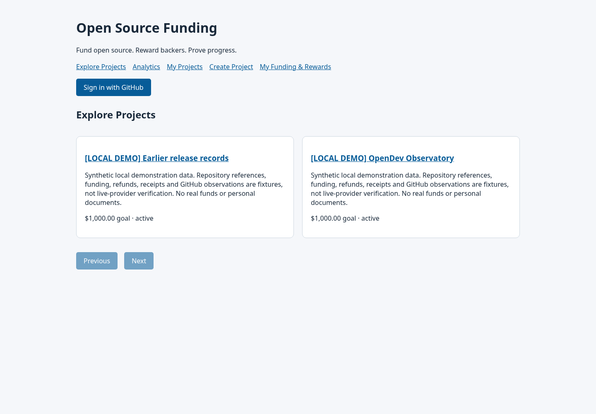
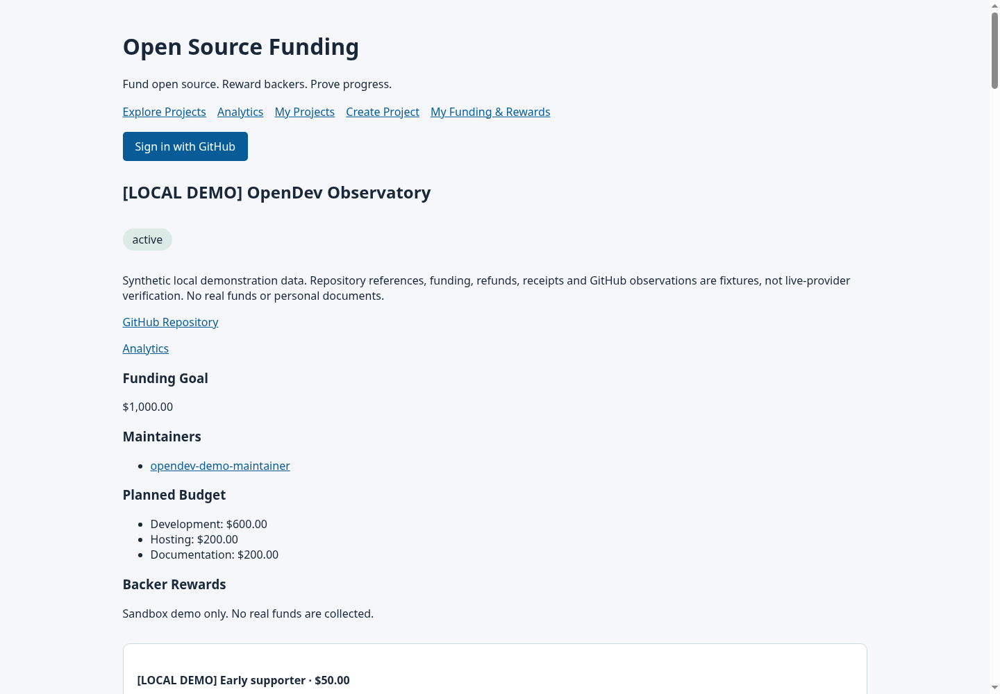
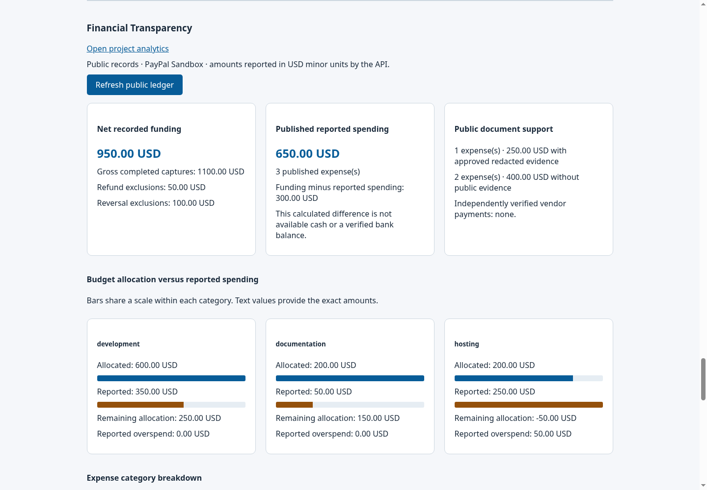
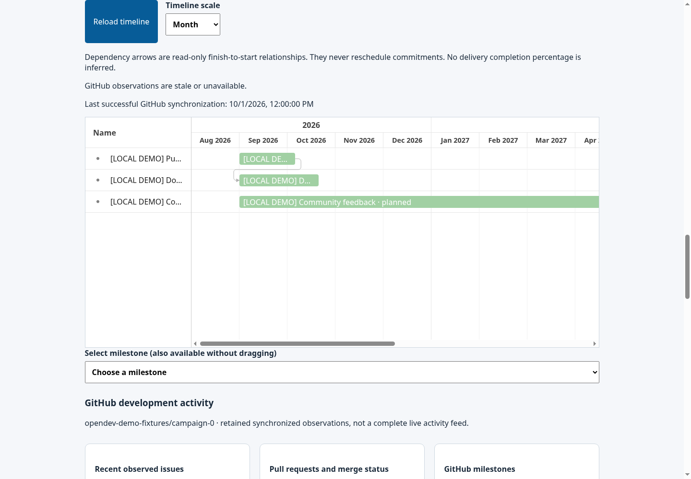
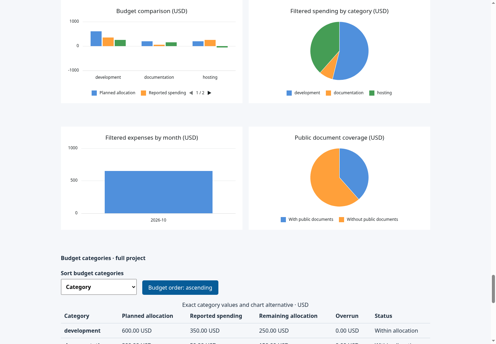
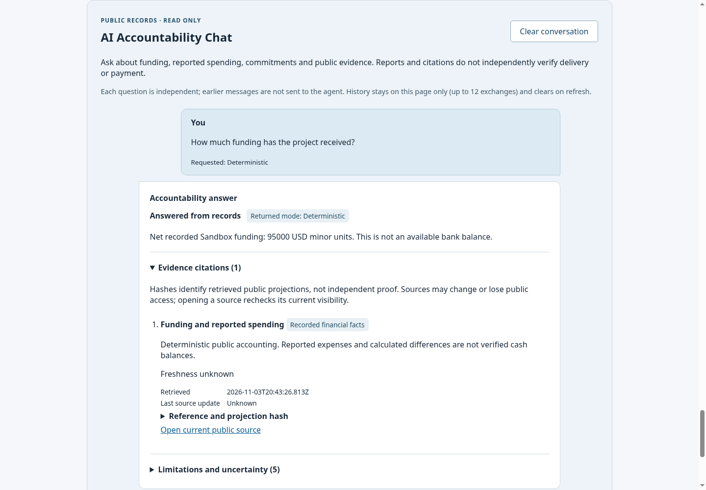
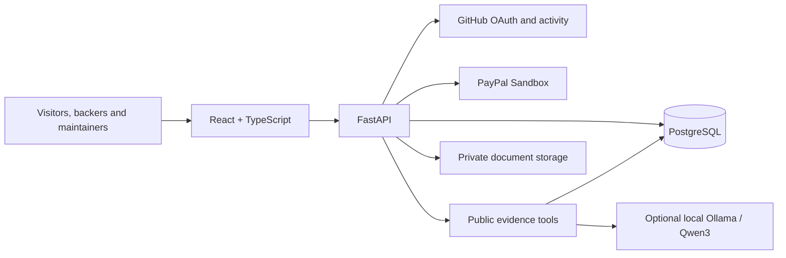

# OpenDev

### Fund the work. See the proof.

**OpenDev** is an AI-powered funding and accountability platform for open-source projects. It helps developers raise support for their work while giving backers a clearer picture of **funding, reported expenses, development progress, and project milestones**.

Instead of stopping at a successful contribution, OpenDev makes it easier to follow what happens next.

[Explore the source code](https://github.com/Avnish666/OpenDev) · [Local setup guide](docs/demo-setup.md) · [Project screenshots](docs/submission/screenshots/README.md)

> **Project status:** OpenDev has been tested locally with PayPal **Sandbox** contributions and an Ollama/Qwen3 accountability answer with a source citation. This does **not** mean the platform is ready to process real money. Live payouts, public hosting, genuine webhook acceptance, and other production security checks need separate validation. The standard synthetic demo uses deterministic answers and does not require external credentials.

## Why OpenDev?

Open-source maintainers need resources to build great software. Backers, meanwhile, want to know how their support is being used and whether promised work is moving forward.

OpenDev connects those two sides through a single workspace: **support a project, review its public financial reports, follow its roadmap, and ask questions backed by project evidence**.

## Key features

- **PayPal Sandbox funding:** Back projects through simulated PayPal payments, with backend-verified captures and reward entitlements.
- **GitHub integration:** Sign in with GitHub, link repositories you own, and view development observations.
- **Transparent reporting:** Publish budgets, expense claims, and approved public supporting-document information.
- **AI Accountability Assistant:** Ask questions about public funding and progress data. The optional **Qwen3 4B model through Ollama** selects read-only evidence tools, while the backend validates and cites the returned records. A deterministic fallback is available.
- **Project roadmaps:** Use **Bryntum Gantt Community** to explore milestones, deadlines, dependencies, and recorded schedule changes.
- **Financial and development analytics:** Explore interactive dashboards powered by **AG Grid Community** and **AG Charts Community**, including filters and CSV exports.
- **Maintainer tools:** Create campaigns, configure rewards, report spending, and update project commitments.

## Screenshots

The images below come from the repository's **earlier local synthetic demo**. They illustrate the available screens, not real-money transfers or a publicly deployed application. The redesigned interface may look different; replace these with fresh, privacy-reviewed captures when ready.

### Explore projects


### Project overview


### Financial transparency


### Roadmap with Bryntum Gantt


### Financial analytics with AG Charts and AG Grid


### Accountability chat (deterministic demo)


See the [complete screenshot gallery](docs/submission/screenshots/README.md) for expense evidence, development analytics, and maintainer history. **The screenshot above shows deterministic mode**; a newer locally verified Ollama/LLM response should be added as a separate, clearly labeled screenshot after checking that it contains no sensitive information.

## Technology stack

| Area | Technologies |
| --- | --- |
| Frontend | React 19, TypeScript, Vite 8, CSS |
| Backend | Python 3.12, FastAPI, SQLAlchemy |
| Database | PostgreSQL 16, Alembic |
| Payments | PayPal Sandbox REST APIs (Orders v2, captures, webhooks) |
| Authentication and activity | GitHub OAuth and GitHub REST API |
| AI | Ollama, Qwen3 4B, read-only evidence tools |
| Charts and tables | AG Charts Community, AG Grid Community |
| Project timeline | Bryntum Gantt Community |
| Document workflow | Supabase private storage, PDFium, pypdf, Tesseract |
| Packaging | Docker |

AG Studio is a **separate optional evaluation integration** under `frontend/studio`; it is **not part of the default Community build** and requires appropriate licensing for public use. APIMatic was used for PayPal development guidance, not as a runtime SDK.

## Getting started

There are two ways to explore OpenDev:

**Option A — Reproducible synthetic demo (recommended for reviewers)**

Follow **[docs/demo-setup.md](docs/demo-setup.md)** for the dedicated local-test database, migrations, sample projects, and guarded launchers. This mode doesn't need PayPal credentials or an Ollama model, and it intentionally disables actual checkout, receipt processing, and model inference.

**Option B — Full local development**

For GitHub OAuth, PayPal Sandbox and Ollama testing, use the normal development servers and your own securely configured providers.

**Prerequisites:** Python 3.12, Node.js 24, npm, PostgreSQL 16 (or Docker), and Git. Install Ollama separately if you want to use the AI model. Tesseract is needed for receipt OCR features and native OCR tests.

From the repository root, set up dependencies in **PowerShell**:

```powershell
python -m venv .venv
.\.venv\Scripts\Activate.ps1
python -m pip install -r backend/requirements-dev.txt
npm ci --prefix frontend
```

Create a local `backend/.env` from `backend/.env.example`. Use a **local, dedicated database**, set `FRONTEND_URL=http://127.0.0.1:5173`, and configure the credentials for whichever integrations you plan to test. Keep payment, receipt and LLM features disabled until their dependencies are ready. **Never commit `.env` files or secrets.**

Apply database migrations from the repository root:

```powershell
cd backend
python -m alembic upgrade head
python -m alembic check
```

Start FastAPI in one terminal (from `backend/`):

```powershell
python -m uvicorn app.main:app --host 127.0.0.1 --port 8000
```

Start React in another terminal (from `frontend/`):

```powershell
$env:VITE_API_URL="http://127.0.0.1:8000"
npm run dev -- --host 127.0.0.1
```

Open **http://127.0.0.1:5173**. The backend health endpoint is available at **http://127.0.0.1:8000/api/health**.

For local AI testing, install Ollama, pull the supported model with `ollama pull qwen3:4b`, and configure `LLM_ENABLED=true`, `OLLAMA_BASE_URL=http://127.0.0.1:11434`, `OLLAMA_MODEL=qwen3:4b`, and `AGENT_MODE=llm` in the backend environment. Only enable the full PayPal Sandbox checkout after its merchant and buyer test accounts are configured.

## How it works



**Privacy and accuracy matter:** financial totals are based on recorded provider observations and published reports. They are **not** verified bank balances. An uploaded receipt doesn't independently prove payment, and GitHub activity doesn't certify that a milestone has been delivered. The AI assistant is read-only and designed to cite public evidence rather than invent financial facts.

## Tests and documentation

The repository includes backend and frontend tests, along with browser-based demo checks. Run the frontend checks from `frontend/`:

```powershell
npm test
npx tsc -b
npm run lint
npm run build
```

Backend tests require a **fresh, migrated, never-seeded test database**, separate from any existing demo or contribution data. See the [validation guide](docs/submission/testing-and-limitations.md) before running the full suite.

More details:

- [Local demo setup](docs/demo-setup.md)
- [Technical architecture](docs/submission/technical-architecture.md)
- [Sponsor integrations](docs/submission/sponsor-integrations.md)
- [Testing and limitations](docs/submission/testing-and-limitations.md)
- [Deployment and remaining release checks](docs/phase7-release-blockers.md)

## Deployment and limitations

OpenDev includes a reviewed **same-origin Docker deployment configuration** at `deploy/Dockerfile`, but a working local demo or deployed backend alone does not establish that the entire platform is publicly production-ready. Public deployment requires additional review of secrets, HTTPS OAuth, database backups, PayPal webhook acceptance, document access controls, licensing, and model hosting. PayPal processing remains **Sandbox-only** in the current implementation.

If you host the backend separately, ensure the frontend is configured with the correct API URL and test cookie/session behavior over HTTPS. Ollama running on your personal computer is not automatically accessible to a hosted backend.

## License

A repository-level open-source license must be chosen and added by someone authorized to grant those rights. Until then, do not assume the application itself is licensed for unrestricted reuse. Third-party components have their own licensing and attribution terms; see [license notes](docs/submission/license-notes.md).

---

**OpenDev — Fund the work. See the proof.**
