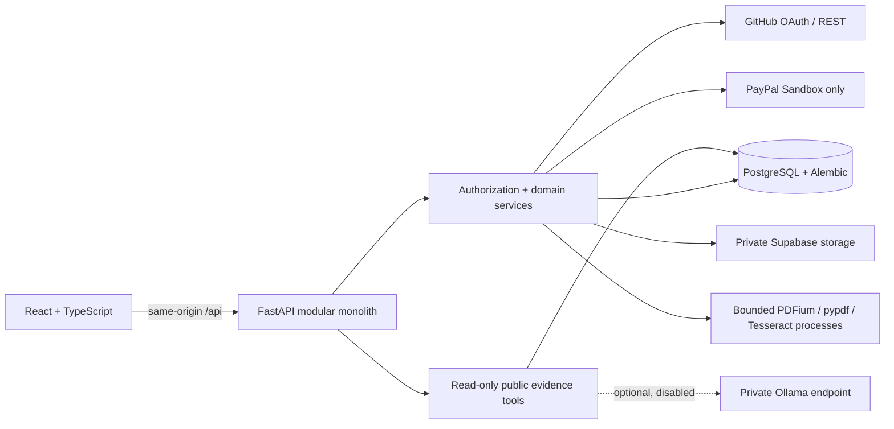

# OpenDev

Fund open-source projects and inspect the evidence behind their spending and delivery.
OpenDev brings campaign funding, reported expenses, GitHub observations, roadmap
commitments, reward fulfillment and cited accountability answers into one application.

**Status: local synthetic demonstration ready; public deployment NO-GO.** Real
PayPal Sandbox acceptance, genuine webhook delivery, Supabase, hosted GitHub OAuth
and real Ollama inference remain unverified. This is not escrow, a payout service,
a bank balance, a fraud detector or independent delivery certification.

Start with the [local demo runbook](docs/demo-setup.md),
[6-minute walkthrough](docs/demo-walkthrough.md), [screenshots](docs/submission/screenshots/README.md)
and [final handoff](docs/phase7-final-handoff.md).

## Problem and users

Backers can see that a campaign raised money without being able to connect spending
to published evidence and delivery commitments. Maintainers need a practical way to
report progress without turning GitHub activity into an unsupported promise of completion.
Visitors explore public campaigns; backers inspect funding and rewards; maintainers
publish budgets, expenses and roadmaps. Public and private records stay separate.

## Features

- GitHub OAuth, hashed cookie sessions, repository ownership checks, draft campaigns and reward tiers.
- Backend-priced PayPal Sandbox orders/captures, verified-webhook reconciliation, immutable refund observations and reward entitlements.
- Published expense ledger, approved-redaction metadata, deterministic budget findings and private PDF/image extraction.
- Retained GitHub observations, linked roadmap evidence, append-only deadline/status history and Bryntum Community Gantt.
- Maintainer outcome indicators with explicit samples and limitations, rather than a trust score.
- Financial/development dashboards, shared filters and bounded CSV exports using AG Grid/Charts Community.
- Public read-only accountability chat with deterministic answers and citations; optional bounded Ollama orchestration is disabled in the default demo.

Implementation and synthetic tests do not establish live-provider acceptance.

## Architecture and stack



React 19, TypeScript 5.9, Vite 8; Python 3.12, FastAPI, SQLAlchemy and psycopg;
PostgreSQL 16 and Alembic. Bryntum Community is pinned to 8.0.0-beta.1. The default
analytics packages are AG Grid Community 36.2.0 and AG Charts Community 14.2.0.
AG Studio 3.0.0 and its Enterprise dependencies are isolated in `frontend/studio`.
The application uses HTTPX for PayPal REST; APIMatic supplied development guidance,
not an invented runtime SDK dependency. See [sponsor evidence](docs/submission/sponsor-integrations.md).

## Local prerequisites and setup

Use Python 3.12, Node 24 (the combined image's version), npm, PostgreSQL 16 or Docker,
and Git. Tesseract plus English data is needed for native OCR tests; no Ollama model
is needed. Linux examples:

```sh
python3.12 -m venv .venv
. .venv/bin/activate
python -m pip install -r backend/requirements-dev.txt
npm ci --prefix frontend
# If not already installed, install tesseract-ocr and tesseract-ocr-eng
# through your operating system's package manager before native OCR tests.
```

`backend/requirements.txt` is a legacy scientific environment; the application uses
`requirements-app.txt`, `requirements-payments.txt` and `requirements-dev.txt`.
Optional Studio is not installed by the normal `npm ci` command. No paid license,
provider credential, model download or production database is required for the demo.

Follow [demo setup](docs/demo-setup.md) to create a disposable loopback-only database,
export the explicit testing configuration, migrate it, seed it twice and start the
API/frontend. It contains complete commands and shutdown instructions. Do not copy
historical sample credentials or use production Neon. Never commit `.env` files;
Vite variables are public bundle configuration, not secret storage.

The migration and launch commands, after the documented local target validation, are:

```sh
(cd backend && python -m alembic upgrade head && python -m alembic check)
python scripts/demo-data.py --environment local-test > /tmp/opendev-demo-manifest.json
python scripts/local-demo.py
# In a second terminal with the same explicit demo environment:
node frontend/demo.mjs
```

Open `http://127.0.0.1:5173/#/explore`. No migrations run during application startup.
No seed command resets a database or overwrites unrelated records. The launcher
binds only to loopback and uses the unchanged authorization routes; there is no demo login bypass.

## Validation

With the activated environment and DATABASE_URL/TEST_DATABASE_URL identifying an
**separate, fresh, migrated and never-seeded** local `opendev_test_*` database (not the demo DB), run the full suite with features enabled
**only for this test process**, where external providers are mocked:

```sh
(cd backend && APP_ENV=testing CHECKOUT_ENABLED=true RECEIPT_PROCESSING_ENABLED=true LLM_ENABLED=true python -m pytest -q)
(cd frontend && npm test && npx tsc --noEmit -p tsconfig.app.json && npx tsc --noEmit -p tsconfig.node.json && npm run lint && npm run build)
python -m pip check
python scripts/release-credential-audit.py --working-only
```

Demo acceptance: `python -m pytest -q tests/test_demo_acceptance.py` from backend.
With both demo servers running and Chromium installed:
`node frontend/tests/browser-demo.mjs /tmp/opendev-demo-manifest.json`.
This captures real application screens, not generated mockups. Current totals and
exact browser/build/image evidence are in [testing and limitations](docs/submission/testing-and-limitations.md).

## Data boundaries and limitations

Public active-project projections expose published expense facts, separately approved
redaction metadata, roadmap changes, retained public GitHub observations and aggregate
outcomes. Original receipts, storage keys, raw OCR, reviewer/backer notes, email and
session secrets remain private. Authorization and read-only tool boundaries run in
backend code. Public citations identify retrieved projections; they do not guarantee
semantic relevance or completeness. Numerical answers and accounting stay deterministic.

Receipts do not prove vendor payment. GitHub activity does not certify delivery.
Unknown historical refunds remain unknown and conservatively excluded. Owner aggregates
cover current active public ownership, not a lifetime track record. Worker-local limits
and decoder process limits do not establish full OS containment. Large beta Gantt and
analytics bundles still need broader device/browser and slow-network acceptance.

## Licensing and deployment

Default Community package declarations are permissive, but the application has **no
authorized root license decision**. No license grant is invented here. PDFium's bundled
notices have been inventoried; whole-app distribution, native/transitive notices and
prior artifacts still need owner signoff. Optional AG Studio/Enterprise is commercial,
local evaluation only where permitted, and excluded from the default build. Evaluation
flags or a trial watermark do not authorize public use. See [license notes](docs/submission/license-notes.md).

`deploy/Dockerfile` and `deploy/environment-manifest.json` are review artifacts for a same-origin
Community image, not evidence of a deployment. Production defaults disable checkout,
receipt processing and LLM. Keep the [release gates](docs/phase7-release-blockers.md)
open until actual evidence closes them. Deterministic hosting is the recommended
zero-budget candidate; model cohosting on Render Free is not established.
No public demo/submission URL or completed video is claimed.
