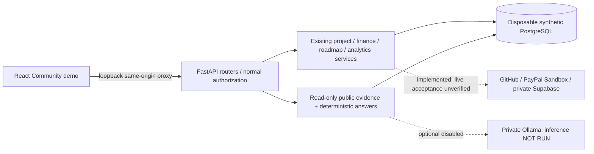

# Phase 7 Step 6 — final demo and release acceptance handoff

Assessment: 2026-11-04, Asia/Calcutta. **GO for isolated local synthetic demonstration;
NO-GO for public deployment.** Submission documents and actual screenshots are prepared.
A video, organizer acceptance, prize eligibility, public demo URL and completed submission
are not claimed. No commit, push, tag, deployment, production migration, provider-side
transaction, model download or commercial license purchase was performed.

## 1. Repository state

Started on `main`, HEAD `fc8fef0` (`Phase 7 Step 4 done`). Steps 1–4 are committed;
Step 5 was implemented but pending. Initial whitespace and current-source heuristic
credential checks passed. Four modified and ten untracked Step 5 files were recorded
with SHA-256 fingerprints before editing; source changes are preserved. The index was
empty and remains unstaged. No history rewrite, reset, clean or discard was performed.

Initial Step 5 paths: provider hardening; `deploy/README.md`; blocker-register amendment;
reusable container-capacity selectors; Ollama acceptance module/wrapper/tests; local
agent-capacity test; evaluation summary script; AI capacity report and four JSON artifacts.
Those documents remain historical Step 5 evidence; Step 6 only adds current links to
shared release/deployment documentation. No migration, dependency pin/lock, financial
calculation, production flag default or authentication route changed.

Step 6 adds guarded demo fixture/launch scripts, public demo acceptance and Chromium
capture infrastructure, root/frontend README, runbooks, the submission package and
this report. Existing browser polling now waits for a document body during navigation.
No new major product feature or demo authentication bypass was introduced.

## 2. Final architecture

The modular monolith and existing interfaces remain. The review Docker image combines
Community static assets and one non-root Uvicorn process; it performs no startup
migration or model download. [Technical architecture](submission/technical-architecture.md)
details financial/refund, receipt, GitHub and AI evidence boundaries.

## 3. Features implemented

Campaigns/reward tiers and GitHub identity/ownership checks; Sandbox financial lifecycle
and idempotent signed-webhook handling; exact immutable refund observations and conservative
unknowns; expense reporting, public approved-redaction projections and private extraction;
GitHub observations; internal commitments, deadline/status history, linked evidence and
Bryntum Community Gantt; owner outcome indicators and reward fulfillment; Community
financial/development/maintainer dashboards, filters/CSV; deterministic cited accountability
answers and optional bounded read-only model orchestration. Implementation plus local
synthetic acceptance does not establish live-provider or production correctness.

## 4. Sponsor integration status

[Evidence matrix](submission/sponsor-integrations.md) maps actual APIs/packages, versions,
source files, mocked/live status, license restrictions and exact demo steps. PayPal REST
uses HTTPX; APIMatic supplied documented development guidance, not a runtime SDK claim.
Bryntum Community renders in real Chromium. AG Studio 3.0.0 is an isolated optional
commercial evaluation adapter, not the Community renderer. Its existing local evaluation
journey passes with genuine trial notices; no public entitlement or Studio screenshot
is claimed. Current hackathon/sponsor rules and eligibility remain owner verification.

## 5. Demo setup and walkthrough

Use [the complete setup](demo-setup.md), [root README](../README.md),
[6:30 walkthrough](demo-walkthrough.md) and [recording narration](submission/demo-script.md).
The demo uses an empty migrated loopback `opendev_test_demo_*` database and explicit
APP_ENV=testing, OPENDEV_DEMO=synthetic-local with checkout/receipt/LLM flags false.
The two CLI wrappers disable ambient application dotenv loading; the frontend launcher
forces Community and binds only loopback. No login shortcut, cookie injection, auth
route override or provider endpoint is added.

`python scripts/demo-data.py --environment local-test` seeds atomically under an advisory
lock and is idempotent. Unrelated nonempty data or a conflicting fixture marker is
rejected; no reset/overwrite is attempted. `python scripts/local-demo.py` and
`node frontend/demo.mjs` start the API/Vite proxy. Fresh portable setup uses port 55438;
this task used the pre-existing dedicated test PostgreSQL fixture on 55437 and a fresh
`opendev_test_demo_step6` DB. The repeated CLI manifest was identical; direct API and
same-origin frontend health/DB-health passed. No provider credentials are needed. Both final guarded launchers exited 0 on SIGINT; the dedicated PostgreSQL fixture was stopped with data retained, and the original environment database remained running.

The data contains two public campaigns/one private draft, synthetic monetary/refund/
reversal/event records, three published expenses/one private, approved evidence metadata,
three main milestones, immutable deadline history/dependency, earlier-release records,
GitHub snapshots and entitlements. Net funding 950 USD, spending 650 USD, difference
300 USD, one Hosting overrun 50 USD. Document metadata has no stored bytes; download is
not a demo/live-storage operation. All public references are labeled fixtures.

Login/creation fallback uses the existing normal-cookie HTTP test with mocked upstream
replies, not a fabricated browser OAuth result. Receipt processing fallback uses genuine
offline synthetic native smoke evidence. Community tables and milestone list remain
fallbacks for charts/beta Gantt. Optional real model acceptance requires approved installed
weights in a separate synthetic local server; Step 5 commands remain authoritative.

## 6. Automated and browser results

| Final check | Actual result |
| --- | --- |
| Complete backend suite, fresh migrated regression DB | **630 passed, 0 failed/skipped/errors**, 2 existing warnings, **334.99 s** |
| New demo acceptance cases | **12 passed**, included in the 630 total |
| Frontend tests | **87 passed**, 0 failed/skipped/cancelled |
| Both TypeScript configurations | Passed, app and node `--noEmit` checks |
| Community and isolated optional Studio builds | Passed; large chunk warnings remain |
| Lint | Passed; two existing AuthContext warnings |
| Existing real Chromium chat journey | **1 passed**, 26 intentionally deselected, 14.44 s |
| Existing real Chromium Community analytics journey | **1 passed**, 6 intentionally deselected, 7.20 s |
| Existing real Chromium isolated Studio evaluation journey | **1 passed**, 6 intentionally deselected, 21.74 s |
| New guarded-demo Chromium acceptance | **Passed**, nine actual public-page screenshots, zero browser runtime exceptions |
| Fresh Alembic upgrade/check | Head `b7a200000001`, no new upgrade operations |
| Restricted current-image production/static/native OCR smoke | Passed; no external provider network |
| Compatibility/dependency/license scope checks | pip check, both npm ls graphs, 18 PDFium notice hashes and default graph isolation passed |
| Advisory metadata | 32/32 Python versions checked, zero reported entries; default npm graph zero reported advisories |
| Credential heuristic / whitespace | Passed; no current-source findings, historical revocation unverified |

The 45/45 deterministic and 7/7 mocked policy evaluations remain a subset of the backend suite; [Step 6 evaluation summary](submission/agent-evaluation.json) keeps them separate from **zero actual Ollama samples**. The new eight-question demo case is additional public synthetic acceptance, not eight real-model tests. Existing backend warnings are Starlette HTTPX TestClient and pypdf add_js deprecations; each browser pytest run has the existing TestClient warning. Optional Studio shows genuine trial notices. No test was silently skipped to obtain these totals.

The 12 demo cases are included in the backend total. Nine screenshots come from a
separate real-browser acceptance of the guarded demo, with no auth/provider overrides.
Three existing Chromium journeys exercise actual React/API/PostgreSQL and mocked
external providers. Local Studio trial success does not authorize public distribution.
See [testing and limitations](submission/testing-and-limitations.md) for complete
commands, warnings, dependencies, failed attempts and evidence boundaries.

The first suite attempt mistakenly used the seeded demo baseline (58 failed/572 passed).
The empty-baseline requirement is now explicit. A subsequent attempt had 65 fixture setup
errors/565 passed from cloud disk exhaustion during migrations. Unused Docker build cache
was reclaimed, preserving source/data volumes, before the final fresh-database run. A
browser initial-document race was fixed in the polling helpers. No product checks were
weakened to obtain final results.

[Machine-readable final results](submission/verification-results.json) record the exact inspected image ID, counts and evidence scope.

## 7. Performance evidence

[Current container sample](submission/local-container-capacity.json): chosen local one-CPU/
512 MiB profile, startup 5.05 s, 20/20 DB-health requests successful at concurrency eight,
median 20.11 ms/max 34.87 ms, three retained DB connections, idle point CPU 0.17%, memory
69.63 MiB/512 MiB, clean stop 0.53 s/exit 0. Synthetic production/no-network OCR smoke:
startup 7.77 s, diagnostic 2.77 s, child CPU 2.24 s, max child RSS 62,400 KiB, whole-container
peak 175,341,568 bytes and idle 67.89 MiB/512 MiB. No hostile/concurrent-upload peak is proven.

Step 5 application workload latencies/SQL/client-resource results remain separate
[historical local measurements](phase7-ai-local-capacity.json). No model daemon/GPU
resource, live inference latency or actual Render measurement exists. A 512 MiB local
cgroup is a chosen test profile, not a verified current Render quota. Deterministic
hosting is the recommended zero-budget candidate; real model cohosting is unproven.

## 8. Security and privacy checks

Current-source credential heuristic and whitespace checks pass; no credential values
or private `.env` files were copied into artifacts. A clean source scan does not revoke
historical secrets. Final screenshots contain only public synthetic material and have
hash/caption evidence. Anonymous APIs withhold private original IDs/keys, draft expense
sentinels and backer notes; the private draft returns 404 and signed-out management
remains protected. Demo accepts no arbitrary DB host/service/query overrides.

Normal production feature defaults, OAuth/session/Origin checks, financial constraints,
read-only evidence scopes, deterministic calculations and actual-mode labels remain.
Citation integrity does not certify semantic relevance. Public findings are category
budget comparisons, not fraud determinations. Receipt reports, delivery and fulfillment
remain assertions. Worker limits are not OS isolation/global quotas; P7-03 stays open.

## 9. Licensing status

The [current inventory](submission/dependency-license-inventory.json) and
[license notes](submission/license-notes.md) distinguish declarations from permission.
All 18 saved PDFium bundled notice hashes match installed pypdfium2 5.14.0; the current
image's no-PyMuPDF/native extraction smoke passes. Runtime replacement is verified;
application/PDFium/native/prior-artifact distribution signoff remains unresolved.
No root LICENSE or contributor authorization was invented.

Community Bryntum/AG declarations are permissive with preservation obligations;
Bryntum is beta and still needs broader acceptance. Optional Studio/Enterprise is
commercial/evaluation, separately installed and absent from the default lock/image.
Recording/sharing trial material also needs applicable terms review. No paid license
is required to run the prepared default demo.

## 10. Real provider acceptance

| Provider | Implemented/local evidence | Actual external acceptance |
| --- | --- | --- |
| GitHub OAuth/repository | Normal-cookie HTTP fixtures and source ownership/state checks | Hosted HTTPS OAuth/cookies/proxy/log acceptance unverified |
| GitHub activity | Bounded sync logic and real DB/browser rendering of fixtures | Step 6 observations seeded, not a live repository audit |
| PayPal Sandbox | Mocked REST/signatures/financial concurrency/refund tests | Real approval/capture/refund and genuine webhook delivery NOT RUN |
| Supabase | Mocked private bucket/access/redaction/signing/cleanup | Real private/public-denial/expiry/cleanup acceptance NOT RUN |
| Ollama | Read-only adapter, deterministic/mock evaluations and guarded future runner | Real inference NOT RUN; no weights downloaded/model resources measured |
| AG Studio | Genuine optional local SDK evaluation/browser journey | Public license and intended recording/sharing rights unverified |
| Render/Neon | Local combined image/migration/capacity evidence | No verified public deployment, target limits or restore rehearsal |

No external success is fabricated from local fixtures. Existing live-provider/AI
reports remain the detailed acceptance prerequisites, not proof those gates closed.

## 11. Final blocker register

This is a current classification, not a replacement for the full
[authoritative register](phase7-release-blockers.md). “Optional feature disabled” does
not mean a complete release gate has been resolved. Owner evidence is still required.

| Gate | Classification | Evidence / rationale |
| --- | --- | --- |
| Historical credential rotation/invalidation (P7-01) | Unresolved blocker | Current-source scan clean; no provider-side revocation/incident completion record. |
| PDFium runtime replacement | Verified resolved, limited scope | Current native smoke/no-MuPDF image and 18 notice hashes verified. This only closes the runtime replacement defect. |
| PDFium/whole-app distribution signoff (P7-02) | Unresolved blocker | Application rights, notices/native/prior artifacts not authorized; no root LICENSE decision. |
| Document-processing isolation/quotas (P7-03) | Unresolved blocker | Limits/shared decoder slot verified; same OS permissions and aggregate quotas unresolved. Upload/processing disabled for the demo. |
| Historical partial refunds/reconciliation (P7-07) | Unresolved blocker | Exact observed refund code/immutability tested; historical/live completeness not verified, unknowns stay NULL/conservatively excluded. |
| PayPal Sandbox acceptance (P7-06) | Unresolved blocker | Local/mocked lifecycle only; no actual buyer/merchant reconciliation. |
| Genuine verified webhook delivery (P7-06) | Unresolved blocker | No approved reachable staging endpoint or provider delivery evidence. |
| Supabase real access/redaction/expiry (P7-08) | Unresolved blocker | No genuine private bucket/object/expiry/cleanup acceptance. Demo evidence is metadata only. |
| Real Ollama (P7-09) | Optional feature disabled; complete AI release remains open | Deterministic mode works; real tool/semantic/adversarial/capacity acceptance absent. No model cohosting assumption. |
| Render Free/Neon capacity and restore (P7-04) | Unresolved blocker | Local chosen limits only; target plan/DB/pool/backup/restore unverified. |
| HTTPS GitHub OAuth/cookies/logs (P7-05) | Unresolved blocker | Normal local HTTP cookie tests do not establish real proxy/TLS/Secure-cookie behavior. |
| AG Studio public authorization (P7-11) | Optional feature disabled | Community default/image exclude commercial graph; optional local evaluation confers no public entitlement. |
| Limited-tier uncertainty (P7-10) | Unresolved blocker for limited tiers | Demo uses unlimited quantity; durable abandoned/uncertain reservation recovery remains open. |
| Retained GitHub/current-owner/assertion scope | Accepted limitation with rationale | Explicit freshness, denominators and notices; no complete audit/lifetime score/independent-delivery claim. |
| Financial/receipt inference scope | Accepted limitation with rationale | Reports are not payments; difference is not bank cash; deterministic arithmetic and safe unknowns remain. |
| Beta/device/bundle, CI/supply chain and native spreadsheet acceptance (P7-12/13/14) | Unresolved acceptance gates | Local builds/Chromium/advisory metadata are narrower than hosted CI, broader browser/device/native CVE/CSV acceptance. |

## 12. Manual owner actions

Use the [submission checklist](submission/submission-checklist.md) in order: verify actual
competition/sponsor rules and deadline; confirm judge repository access; close exposure/
licensing sharing requirements; reproduce/rehearse; record/review the real 5–7-minute
video; select privacy-reviewed real screenshots; explicitly approve any commit/push/tag;
upload the actual approved video and verify access; fill the real form with accurate
status and real links; submit and retain the genuine confirmation. No submission field
should force an unapproved public deployment. Request the organizer's permitted local
alternative if applicable. Separately close public release gates with actual evidence.

## 13. Submission package inventory

- `README.md`, `frontend/README.md`: current product/setup/data/license/status guidance.
- `docs/demo-setup.md`, `docs/demo-walkthrough.md`: complete local commands and timed navigation/questions/fallbacks.
- `docs/submission/project-summary.md`, `technical-architecture.md`, `sponsor-integrations.md`, `demo-script.md`, `testing-and-limitations.md`, `submission-checklist.md`: the six requested core submission documents.
- `docs/submission/license-notes.md`, `demo-answers.json`, dependency/advisory JSON and `local-container-capacity.json`: scope-limited evidence and remaining signoff.
- `docs/submission/screenshots/README.md`, `evidence.json`, nine PNGs: genuine browser captures and hash/caption manifest.
- `backend/app/acceptance/demo.py`, `scripts/demo-data.py`, `scripts/local-demo.py`, `frontend/demo.mjs`: guarded fixture and loopback launchers, no auth bypass.
- `backend/tests/test_demo_acceptance.py`, `frontend/tests/browser-demo.mjs`: safety/idempotence/public acceptance and actual capture automation.
- Existing chat/analytics browser helpers: document-ready polling fix. Blocker/deployment docs: current handoff links.

No video file, submission approval/URL, commercial key or root license is invented.

## 14. Recommended commit and release-tag procedure

**Recommendation only; no Git mutation executed.** Keep `main` at its current reviewed
base until the owner approves a concrete staged result. Suggested sequence:

1. Review and stage only the initial 14 Step 5 paths/hunks; message `Phase 7 Step 5 done`.
   Shared blocker/deployment docs contain Step 6 links now, so use reviewed partial hunks
   or keep those link hunks with the Step 6 commit. Never blanket-stage ignored files.
2. Review/stage the Step 6 fixture, launchers, tests/browser helper fix, READMEs, runbooks,
   submission artifacts/screenshots and current handoff links; message
   `Phase 7 Step 6 demo and submission package prepared`.
3. Before each approved commit inspect `git diff --cached --check` and
   `git diff --cached --stat`, run the current-source scan and inspect staged contents
   without exposing secret values. Exclude `.env`, caches, venv/node_modules, build output,
   raw private evaluation traces and local databases. Preserve the synthetic label on PNGs.
4. After approved commits/checks/owner review, push through the separately authorized
   workflow and verify remote SHA/access. Do not amend/rewrite old history.
5. Proposed annotated tag: **`v0.1.0-demo-rc1`**, pointing to the exact reviewed Step 6
   commit, described as a local synthetic demo candidate with public release NO-GO.
   Create/push it only after explicit approval and checking it does not already exist.
   It must not imply verified production release or sponsor eligibility.

The final owner should record the actual resulting hashes/tag only after those actions.
This report deliberately contains no fabricated future commit SHA or pushed tag.

## 15. GO / NO-GO conclusion

**GO: isolated synthetic local review, rehearsal and owner preparation of a truthful
hackathon video/submission. NO-GO: public deployment or a claim of full live-provider/
production acceptance.** Deterministic evidence functionality is useful without hosted
LLM infrastructure. The remaining credential, licensing, containment, provider,
HTTPS/hosting/restore and broader acceptance gates still need real evidence. No feature
flag, local test count or evaluation license silently clears them.
