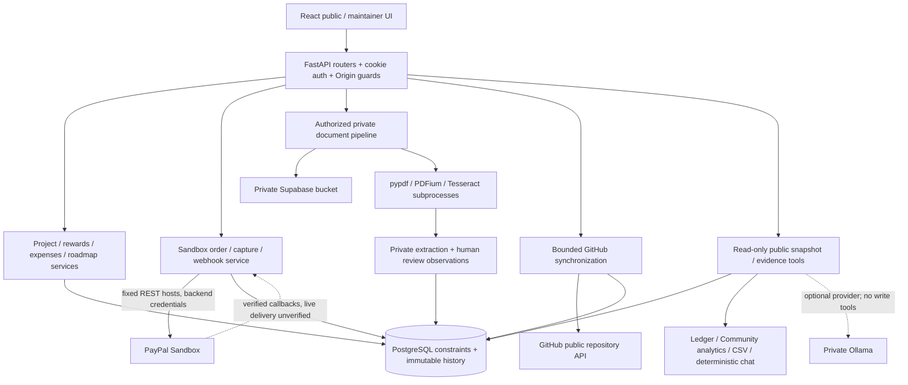

# Technical architecture

OpenDev is a React/FastAPI modular monolith. Routers delegate to domain services;
SQLAlchemy models and a linear Alembic history share PostgreSQL. The proposed
review image serves built Community assets and `/api` from the same origin.
The local demo uses a loopback Vite proxy with normal authorization intact.

## Financial flow

Server-stored tier snapshots determine Sandbox prices/currency. Stable request keys,
row locks and unique order/capture/event/entitlement constraints keep retries bounded
and idempotent. Capture attribution and webhook signature verification precede committed
financial effects. Refund records are immutable and tied to capture/event IDs;
reversal takes precedence. Known cumulative refunds reduce the recorded capture;
unknown affected captures are conservatively excluded. Reported expenses are separate
from captures. Funding minus reported expenditure is an arithmetic difference, not cash.

Sources: `backend/app/services/funding.py`, `services/paypal.py`, `models/funding.py`,
`migrations/versions/b7a200000001*` and `services/accountability.py`.

## Receipt and privacy flow

Authorize upload before body/storage, validate bounded file content, retain originals
privately, run bounded native extraction, store structured private observations and
append-only human reviews. Public evidence requires a separate approved redaction.
Raw OCR, filenames/keys, original documents, review/backer notes and secrets are excluded
from public projections and the model's tools. Processes still share application OS
permissions; full decoder isolation and global quotas remain unresolved.

Sources: `routers/documents.py`, `services/documents.py`,
`services/receipt/{pipeline,provider,worker}.py`, `services/transparency.py`.
The Step 6 fixture seeds metadata only and does not use live storage or extraction.

## Development and AI evidence flow

GitHub sync retains bounded repository/issue/PR/milestone/commit observations, timestamps
and failure/staleness state. Internal commitments and original/revised deadlines are
separate immutable histories. Linking evidence does not certify delivery. Public
maintainer outcomes cover current active owned projects with explicit denominators.

Public chat opens a read-only repeatable-read snapshot. Deterministic intents call
allowlisted evidence tools. Optional Ollama can select validated tools and typed claims,
while backend code validates scope/citations and renders financial calculations.
Context, output, turns, tool calls, time and worker admission are bounded. A valid
projection hash proves provenance, not semantic relevance. No AI financial writes exist.
LLM_ENABLED=false forces actual deterministic mode even if a client asks for LLM.

Sources: `services/{github_progress,roadmap,credibility,analytics}.py`,
`agent/{tools,orchestration,financial_reasoning,development_reasoning,providers}.py`.

## Security and operational boundaries

Normal OAuth state validation, random hashed expiring sessions, HttpOnly cookies,
production Secure cookies, trusted-Origin checks and project authorization stay in
backend code. Provider credentials remain backend-only; Vite config is public.
Production startup checks/default-off gates, a non-root image, private scratch files,
no-store API headers and sanitized provider errors reduce exposure. They do not prove
hosted OAuth, upstream log redaction, complete OS containment, current free-host
capacity, backup restoration or legal permission to distribute the whole application.
See [final gates](../phase7-final-handoff.md#11-final-blocker-register).
